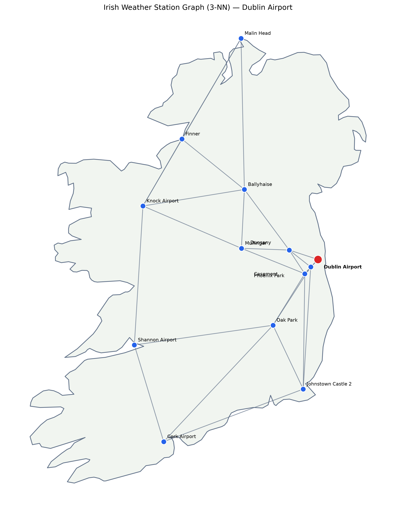

# AIFW_GNN_Project

## GNN for Irish Weather Forecasting

This project uses Graph Neural Networks (GNNs) to predict air temperature at Dublin Airport 6 hours ahead, based on historical observations from 13 Irish weather stations.

### Dataset
- **Source:** Met Éireann hourly weather observations
- **Period:** 2022–2025
- **Features:** Temperature, mean sea level pressure, relative humidity, and rainfall
- **Graph:** 13 weather stations connected using 3-nearest neighbours based on geographical distance 
- **Input:** Previous 24 hours of observations

### Models
- Persistence benchmark
- 2-layer Graph Convolutional Network (GCN)
- 3-layer Graph Convolutional Network (GCN)

The models are trained on 2022–2023 data, validated on 2024, and tested on 2025.

### Results

| Model | MAE (°C) | RMSE (°C) |
|---|---:|---:|
| Persistence | 2.5112 | 3.3900 |
| 2-layer GCN | 1.4070 | 1.8130 |
| 3-layer GCN | **1.3796** | **1.7892** |

Both GCN models outperform persistence, reducing test RMSE by approximately 47%. The performance difference between the two GCN architectures is small and varies across random seeds.

### Tools
Python, PyTorch Geometric, Pandas, NumPy, NetworkX, and GeoPandas.

### Data Source
[Met Éireann Historical Weather Data](https://www.met.ie/climate/available-data/historical-data)